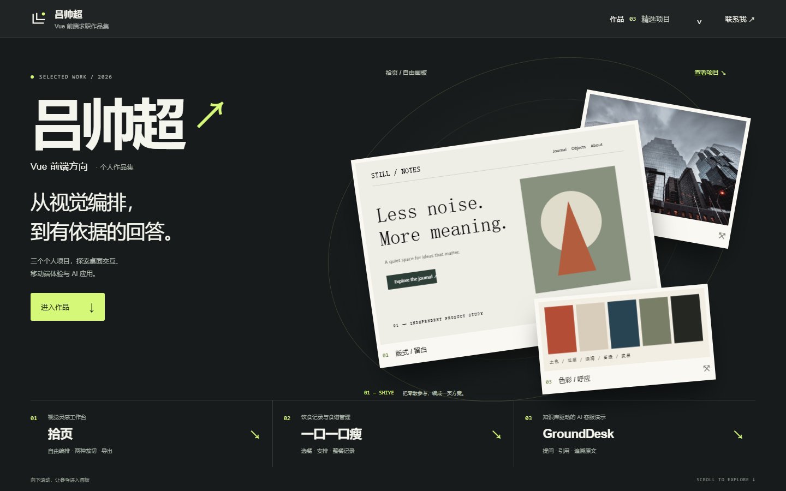
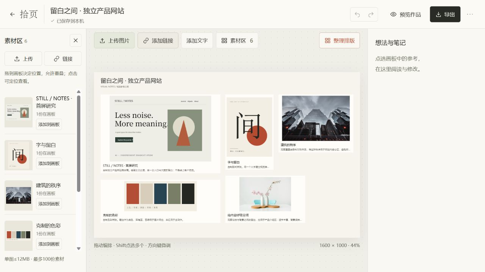
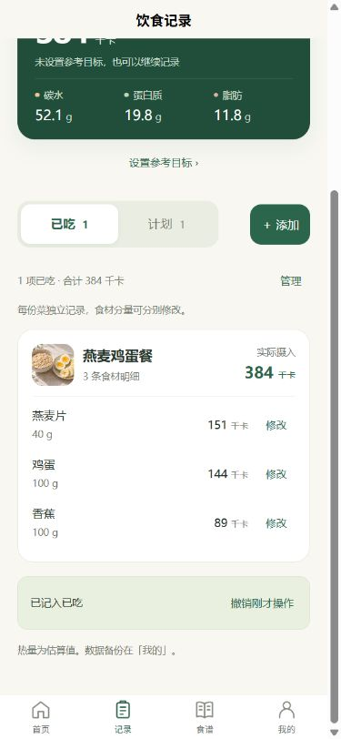
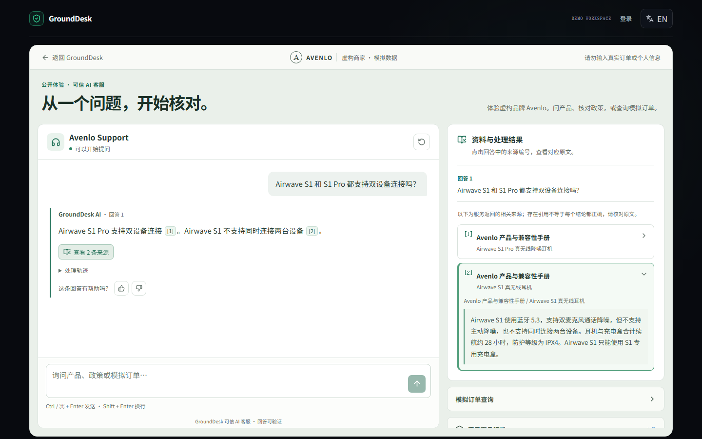

# 吕帅超 · Vue 前端作品集

从视觉编排，到有依据的回答。用三个个人项目，展示具体问题如何变成可体验的界面与交互。

**[打开作品集 →](https://lsc-261013.github.io/lv-shuaichao-portfolio/)**

[拾页](https://lsc-261013.github.io/lv-shuaichao-portfolio/#shiye) · [一口一口瘦](https://lsc-261013.github.io/lv-shuaichao-portfolio/#diet) · [GroundDesk](https://lsc-261013.github.io/lv-shuaichao-portfolio/#grounddesk)

作品集真实首页 · 桌面浏览器截图（2026-10-14）。点击图片进入网站，体验滚动转场与互动展厅。

## 不止看截图，也能动手体验

- **把参考编成一页方案：**首屏素材随自然滚动进入拾页画板，可拖动、用方向键调整、整理和重置，也可切换查看真实编辑器。
- **拆开一餐，再合成一份记录：**随滚动查看搭配、待吃计划与确认记录；步骤也可直接点选，核对每条配料与实际分量。
- **让引用带人找到依据：**在 GroundDesk 案例中切换回答与两条来源，阅读对应原文，再查看真实产品界面。

三个项目均提供具体迭代与方案取舍；真实截图可放大。页面适配手机，支持键盘操作与减少动态效果设置。

## 三个项目

### 01 / 拾页 · 视觉灵感工作台

收集图片、来源与借鉴点，在自由画板中编排、裁切、标注，并导出方案图片、参考文本或完整备份。一次关键取舍：新素材按落点加入，保留已经排好的画面。

**[打开拾页](https://lsc-261013.github.io/shiye-workbench/) · [项目源码](https://github.com/lsc-261013/shiye-workbench)**

新版已发布。草稿保存在当前浏览器，无账号或云同步；手机支持查看与轻量编辑。

### 02 / 一口一口瘦 · 饮食记录与食谱管理

围绕“选餐—安排—记录”组织一顿饭，支持自建食谱、待吃计划与整餐记录。一次关键迭代：保留菜名、份次和配料分组，让一道菜不再变成散落的食材记录。

**[查看作品集中的流程](https://lsc-261013.github.io/lv-shuaichao-portfolio/#diet) · [项目源码](https://github.com/lsc-261013/fat-loss-mini)**

第二版已于 **2026 年 10 月 14 日上午上线微信**；此处展示实际 H5 流程截图。食谱、计划与记录使用本地存储，推荐按规则生成。

### 03 / GroundDesk · 有依据的客服问答

将带引用回答、原文追溯、演示订单与人工处理路径放进同一个客服流程。一次关键迭代：回答编号联动来源，重复点击仍能定位，手机查看后可以返回回答。

**[打开在线 Demo](https://grounddesk-ai-lsc.onrender.com/demo) · [项目源码](https://github.com/lsc-261013/grounddesk-ai)**

在线 Demo 已于 2026 年 10 月 14 日更新。Avenlo 为虚构商家，资料与订单是合成演示内容；作品集回放已记录案例，在线 Demo 为独立应用。

查看三个项目的实际界面截图

**拾页 · 公开示例编辑器（2026-10-08）**

**一口一口瘦 · H5 整餐记录（2026-10-08，非微信真机截图）**

**GroundDesk · 合成案例的问答与来源（2026-10-07）**

截图记录各自采集时的界面；完整交互请进入作品集或对应应用。

## 实现与仓库用途

作品集以 **Vue 3 Composition API、TypeScript、Vite** 实现，使用 CSS 变量与原生滚动组织转场、指针反馈和分步展示，并为截图提供临近预取、加载与失败反馈。

本仓库用于 **GitHub Pages 静态发布**；三个应用的源码见各项目链接。

直接体验已部署的网站：**[打开吕帅超的作品集 →](https://lsc-261013.github.io/lv-shuaichao-portfolio/)**。

我负责需求梳理、交互取舍、页面问题定位与体验验收，结合 AI 工具推进实现与迭代。各项目中的具体问题、方案选择和改进结果，可在作品集内展开查看。
